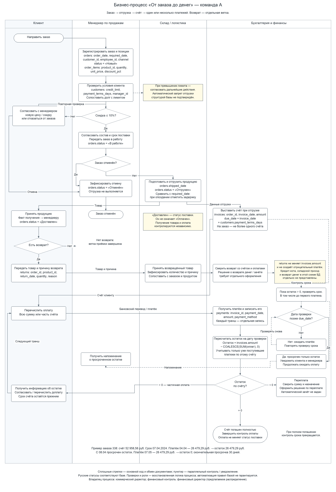

Модуль 0. От заказа до денег

Товстюк Е. А. Команда А «Финансы и продажи».

О.1. Какие таблицы есть в базе

Справочники — customers, employees, products, product_categories, regions, suppliers, raw_materials, production_lines, recipes.

Документы и операции — orders, order_items, invoices, payments, purchase_orders, purchase_order_items, production_batches, material_consumption.

События и потери — returns, equipment_downtime, material_writeoffs. Планы и учёт — sales_plan, expenses, price_history. Всего 23 таблицы.

О.2. Какие поля обязательны

В orders обязательны order_id, order_number, customer_id, employee_id, order_date, required_date, status и channel. Дата заказа известна при оформлении. shipped_date появляется после отгрузки и остаётся пустой при отмене. comment заполняют по необходимости.

В payments обязательны payment_id, invoice_id, payment_date, amount и payment_method. Одна запись соответствует одному платежу.

О.3. Как связаны таблицы

У клиента может быть несколько заказов. Сотрудник может оформить несколько заказов. В заказе может быть несколько позиций, а один товар может встречаться в разных позициях. По одному счёту может быть несколько платежей. Всего в базе 30 внешних ключей. В employees есть ссылка на руководителя, а в product_categories есть ссылка на родительскую категорию.

О.4. Кто отвечает за процесс

В отделе продаж менеджеры подчиняются Ершовой, Ершова — Громову, а Громов — Орлову. В финансах Тихонова подчиняется Котовой, Котова и Егоров — Беловой, а Белова — Орлову. За весь процесс может отвечать Громов, за контроль оплат — отдел Беловой.

А.1. Чем различаются условия клиентов

Лимит ограничивает допустимый долг, отсрочка определяет срок оплаты, manager_id указывает закреплённого менеджера. Лимит и отсрочка: розница — 300 тыс. и 7 дней, HoReCa — 500 тыс. и 14 дней, дистрибьюторы — 3–4 млн и 30 дней, региональные сети — 5 млн и 30 дней, маркетплейсы — 6 млн и 30 дней, федеральные сети — 15 млн и 45 дней. ООО «Ромашка» (№ 2) имеет лимит 4 млн вместо 3 млн.

А.2. Что произошло с заказом 338

ООО «Гамма», менеджер Ирина Семенова. Заказ оформлен 02.03.2024, отгружен 08.03 за 6 дней, на день раньше требуемой даты. Счёт выставлен 08.03 на 52 958,58 руб. Срок оплаты 07.04 (30 дней отсрочки).

04.04 клиент внёс 26 479,29 руб. К сроку оставалась вторая половина. Её оплатили 07.05, на 30 дней позже срока. 13.03 вернули 57 единиц кефира из-за истечения срока годности. Срок хранения кефира — 10 дней.

А.2. Чем отличается заказ 4000

ООО «Лента-Сервис», менеджер Сергей Павлов. Заказ оформлен 26.10.2025, отгружен 27.10 за день, на четыре дня раньше срока. Счёт на 251 095,60 руб. выставлен 27.10. Срок 11.12 (45 дней отсрочки). Клиент оплатил всю сумму одним платежом 17.12, на 6 дней позже срока. Возвратов нет.

А.3. Какие состояния проходит заказ

У нового заказа статус «Новый». Когда заказ берут в работу, статус меняется на «В работе». После отправки ставят «Отгружен», а после получения товара клиентом ставят «Доставлен». Если заказ отменяют до отгрузки, ставят «Отменён». В данных 22 новых, 17 в работе, 30 отгруженных, 4 212 доставленных и 177 отменённых. Дата отгрузки есть только у отгруженных и доставленных. Оплата и возврат учитываются отдельно.

А.4. Как сравнить план и факт

В sales_plan хранится план на месяц по каждой верхней категории. Чтобы получить факт, берём отгруженные заказы, считаем стоимость позиций со скидкой и складываем по месяцу отгрузки и категории. В price_history указано, когда действовала цена. Если valid_to пустое, период ещё открыт.

Статьи расходов включают логистику, комиссию маркетплейса, аренду, ИТ, командировки, маркетинг, ремонт и энергоресурсы. У логистики и комиссии канал указан. У остальных он не задан.

А.5. Какие правила соблюдаются

1. Скидка до 10% по order_items.discount_pct — 4 365 превышений из 17 576 позиций.
2. Один счёт на отгруженный заказ — invoices.order_id уникален, отгрузок без счёта нет.
3. Срок оплаты равен дате счёта плюс отсрочка клиента — расхождений нет.
4. Количество в позиции больше нуля — нарушений нет.
5. Каждый платёж связан со счётом через invoice_id — платежей без счёта нет.
6. Счёт погашается к due_date — оба разобранных счёта полностью погашены позже срока.

А.6. Как работает частичная оплата

Каждый платёж записывают отдельно. Чтобы узнать остаток, из суммы счёта вычитают все оплаты по нему. Если остаток больше нуля, ждут доплату. Срок оплаты не меняется. После этой даты просрочен только остаток. Когда он равен нулю, счёт оплачен.

Три вопроса о потерях

1. Кто назначал скидки свыше 10% и насколько они снизили выручку?
2. Какой объём задолженности просрочен и на сколько дней?
3. Какие товары и регионы дают больше возвратов и почему?

Схема процесса

